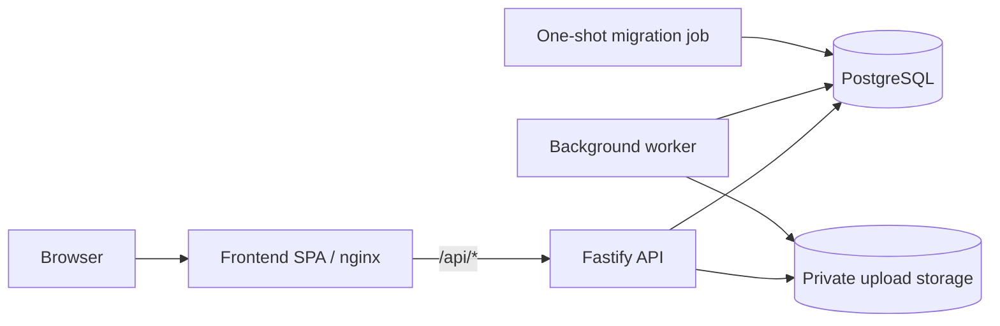

<div align="center">


# BhoomiTrace

### AI-assisted land-record verification and parcel-lineage platform

BhoomiTrace links land-record evidence to traceable values, checks parcel lineage and area/share arithmetic, and surfaces explainable discrepancies for human review.

**Track:** LandTech 2026 &nbsp;·&nbsp; **Challenge:** AI-assisted land-record verification

### 🌐 [Live Demo — devtree.online](https://devtree.online/)

[](https://devtree.online/)
[](https://github.com/mosabbir-maruf/BhoomiTrace/actions/workflows/ci.yml)
[](https://github.com/users/mosabbir-maruf/packages/container/bhoomitrace-backend)
[](https://github.com/users/mosabbir-maruf/packages/container/bhoomitrace-frontend)
[](https://github.com/mosabbir-maruf/BhoomiTrace/blob/main/LICENSE)

[](https://nodejs.org/docs/latest-v24.x/api/)
[](https://www.typescriptlang.org/docs/)
[](https://fastify.dev/docs/latest/)
[](https://www.postgresql.org/docs/)
[](https://react.dev/learn)
[](https://vite.dev/guide/)
[](https://tailwindcss.com/docs)
[](https://vitest.dev/guide/)

</div>

> **Demo scope:** The demo uses synthetic records. BhoomiTrace supports verification and review; it does not determine legal ownership or issue official legal approval.

---

## 1. Run locally — judge quickstart

The fastest way to evaluate the project is to run the complete stack with Docker Compose. You do not need to install Node.js or PostgreSQL on the host for this path.

### Prerequisites

- Git
- Docker Engine or Docker Desktop
- Docker Compose v2 (the command **docker compose version** should work)
- At least 2 CPU cores and 4 GB RAM recommended for the full stack

### Start the application

```bash
git clone https://github.com/mosabbir-maruf/BhoomiTrace.git
cd BhoomiTrace

# Optional: copy local-only defaults if you want to customise ports/settings.
# Compose can run without this file.
cp .env.example .env

docker compose config --quiet
docker compose up -d --build
docker compose ps
```

Open the frontend at **http://127.0.0.1:5173**. Check that the API is ready:

```bash
curl --fail --show-error http://127.0.0.1:3000/health
```

On first startup, Compose waits for PostgreSQL health and the one-shot migration service before starting the API and worker. The image is built from the source on your machine; this quickstart does not depend on pulling the published GHCR images.

### Optional: load synthetic records and create a local reviewer account

Run these only against your local development database. The seed command loads synthetic data; the account command prints a generated password once, so save it locally.

```bash
docker compose run --rm --no-deps --entrypoint node api dist/db/seed-cli.js
docker compose run --rm --no-deps --entrypoint node api dist/cli/bootstrap-account.js --email judge@example.test --role admin --name "Judge Demo"
```

If you re-run account creation, use a different email or check the account first. Do not use real identity records or real land records in this demo environment.

### Services and local URLs

| Service | Local address | Purpose |
| --- | --- | --- |
| Frontend | http://127.0.0.1:5173 | React SPA served by unprivileged nginx; proxies /api to the API |
| API | http://127.0.0.1:3000 | Fastify REST API; /health readiness and /health/live liveness |
| PostgreSQL | 127.0.0.1:5433 | Development database; bound to loopback only |
| Worker | No host port | Background document-processing jobs |
| Migration job | No host port | Applies database migrations once during startup |

The ports are loopback-only and are not exposed to other machines by default. If a port is already occupied, change **FRONTEND_HOST_PORT**, **API_HOST_PORT**, or **POSTGRES_HOST_PORT** in your local **.env**, then recreate the stack.

### Logs, restart, and stop

```bash
docker compose ps
docker compose logs -f api
docker compose logs -f worker
docker compose logs -f frontend

# Stop containers while preserving local database and uploaded files.
docker compose down
```

**Do not use docker compose down -v** unless you deliberately want to delete the named database and uploads volumes.

## 2. Environment configuration

The root **[.env.example](.env.example)** is the example environment for local Docker Compose. The stack has safe local defaults and works without a root .env file; copy the example only when you want to override them.

| Variable | Example default | What it controls |
| --- | --- | --- |
| POSTGRES_USER | bhoomitrace | Local PostgreSQL user |
| POSTGRES_PASSWORD | bhoomitrace | Local-only password; never reuse it in a deployment |
| POSTGRES_DB | bhoomitrace | Main local database |
| POSTGRES_TEST_DB | bhoomitrace_test | Integration-test database |
| POSTGRES_HOST_PORT | 5433 | Host port for PostgreSQL, bound to 127.0.0.1 |
| API_HOST_PORT | 3000 | Host port for the API, bound to 127.0.0.1 |
| FRONTEND_HOST_PORT | 5173 | Host port for the frontend, bound to 127.0.0.1 |
| CORS_ALLOWED_ORIGINS | http://localhost:5173,http://127.0.0.1:5173 | Allowed browser origins |
| EXTRACTION_PROVIDER | mock | Offline deterministic provider; no API key required |
| LOG_LEVEL | info | Backend logging verbosity |

Use the examples that match your workflow:

- **[Root .env.example](.env.example):** local Compose settings.
- **[Backend .env.example](backend/.env.example):** direct backend development and optional extraction-provider variables.
- **[Production stack.env.example](deploy/env/stack.env.example):** non-secret deployment settings; it is a template, not a ready-to-run configuration.
- **[Production deployment runbook](deploy/README.md):** secrets, AWS IAM, TLS, persistent storage, backups, health checks, and rollback.

Never commit real credentials, API keys, passwords, tokens, or a populated production secrets file. For local evaluation, keep **EXTRACTION_PROVIDER=mock** unless you have separately configured and tested a supported provider.

## 3. How the services fit together



The frontend and API use the same origin through the nginx /api/ proxy, which keeps cookie-based sessions and CSRF handling on that origin. The worker is a separate process; it reads queued work and shares the backend upload storage. The migration job must finish successfully before the API and worker start.

## 4. Repository map

```text
.
├── .github/
│   ├── scripts/
│   │   ├── ghcr-retention.sh
│   │   ├── mock-ghcr-server.js
│   │   └── test-ghcr-retention.sh
│   └── workflows/
│       ├── ci.yml
│       ├── publish-image.yml
│       └── ghcr-retention-report.yml
├── backend/
│   ├── src/                    API, worker, database, and CLI source
│   ├── test/                   Unit and integration tests
│   ├── drizzle/                Database migrations
│   ├── Dockerfile
│   ├── package.json / package-lock.json
│   ├── .env.example
│   └── README.md               Backend development guide and API contracts
├── frontend/
│   ├── src/                    React UI, API client, and demo data
│   ├── tests/                  Unit/contract and browser test files
│   ├── public/                 Static assets and favicon
│   ├── nginx/                  SPA fallback and /api proxy
│   ├── Dockerfile
│   ├── package.json / pnpm-lock.yaml
│   └── README.md               Frontend development guide
├── deploy/
│   ├── docker-compose.prod.yml Separate single-host deployment stack
│   ├── env/stack.env.example   Production non-secret configuration template
│   ├── scripts/                Preflight, deployment, backup, restore, rollback
│   ├── edge/                   HTTPS edge proxy configuration
│   ├── systemd/                Scheduled health, backup, and certificate tasks
│   ├── cloudwatch/alarms.md    Monitoring and alerting runbook
│   └── README.md               Production deployment runbook
├── docker/postgres/init/       Local database initialisation
├── .env.example                Local Compose environment template
├── docker-compose.yml          Local development stack
├── LICENSE
└── README.md                   Judge quickstart and project overview
```

## 5. Development and tests

The Docker Compose quickstart above is the recommended first run. For component-level development, use the focused guides so you have the exact runtime, scripts, and API contracts for that component.

- **[Backend guide](backend/README.md):** Node.js 24 via mise, database migrations/seeding, authentication and admin bootstrap, REST API, worker behavior, and backend tests.
- **[Frontend guide](frontend/README.md):** React/Vite development, API integration, unit/contract tests, TypeScript checks, build, and Playwright flows.
- **[Deployment runbook](deploy/README.md):** separate production Compose project, immutable container references, host setup, TLS, secrets, backups, restore, rollback, and limitations.
- **[Monitoring runbook](deploy/cloudwatch/alarms.md):** CloudWatch log shipping, metrics, alarms, SNS subscription confirmation, and alert-delivery proof.

Typical frontend checks (run from frontend/ after installing dependencies):

```bash
pnpm test
pnpm exec tsc --noEmit
pnpm run build
```

Backend setup and commands depend on the pinned Node.js 24 toolchain; follow the backend guide rather than relying on a globally installed Node version.

## 6. CI and container packages

GitHub Actions runs the repository's CI workflow for relevant changes. It covers backend checks and tests, frontend checks and build, retention-script tests, and Compose/image smoke validation. The publish workflow builds and publishes the backend and frontend containers to separate GitHub Container Registry packages on pushes to main, version tags, or manual dispatch.

- **[CI workflow and run history](https://github.com/mosabbir-maruf/BhoomiTrace/actions/workflows/ci.yml)**
- **[Image publishing workflow](https://github.com/mosabbir-maruf/BhoomiTrace/actions/workflows/publish-image.yml)**
- **[Backend image package](https://github.com/users/mosabbir-maruf/packages/container/bhoomitrace-backend)**
- **[Frontend image package](https://github.com/users/mosabbir-maruf/packages/container/bhoomitrace-frontend)**

The publish workflow emits an immutable full-commit SHA tag (sha-<40 hex>) as well as convenience tags. For reproducible deployments, prefer an immutable SHA tag or digest over latest. The root Compose quickstart deliberately builds locally from source so judges can run the project independently of registry availability.

## 7. Project scope and limitations

BhoomiTrace helps organise evidence, compare reported land-record values, trace parcel lineage, and record review decisions. It is not a title registry and cannot establish legal ownership.

- The public demo should be treated as a **synthetic-data demonstration**, not as a legal or government decision system.
- Findings identify discrepancies for a human reviewer; a survey difference is not automatically evidence of fraud.
- The extraction-review interface includes a prototype path that is not backed by a complete live extraction-review API contract.
- OCR and live Gemini/Groq extraction are not verified end-to-end in the current deployment baseline.
- The single-host deployment is not highly available. The deployment guide marks AWS-specific steps that still require verification against real AWS resources.

## License

Released under the [MIT License](LICENSE).
